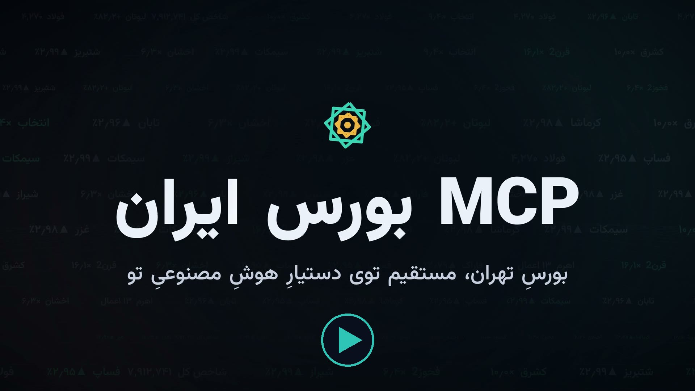
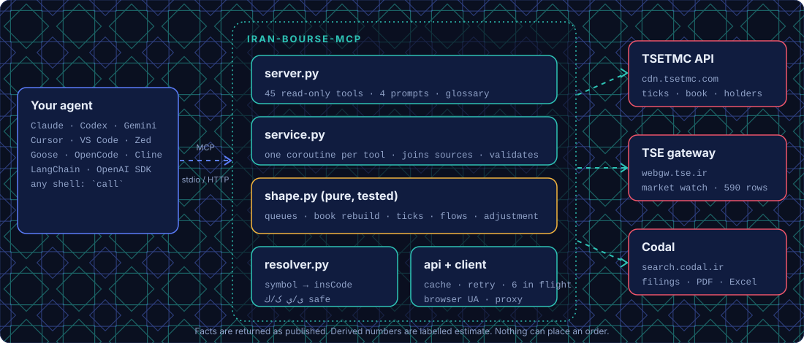

<div dir="rtl">

<div align="center">



<br>

[](https://github.com/msmahdinejad/iran-bourse-mcp/actions/workflows/ci.yml)
[](LICENSE)
[](pyproject.toml)
[](docs/TOOLS.md)
[](https://github.com/msmahdinejad/iran-bourse-mcp/stargazers)

**[وب‌سایت](https://msmahdinejad.github.io/iran-bourse-mcp/)** · **[نصب](#نصب)** · **[بنچمارک](#بنچمارک)** · **[راهنمای کامل](docs/GUIDE.fa.md)** · **[مرجع ابزارها](docs/TOOLS.md)** · **[اسکرینر](docs/SCREENER.md)** · **[نمونه خروجی‌ها](docs/EXAMPLES.md)** · **[نکات داده](docs/DATA_SOURCES.md)** · **[English](README.md)**

</div>

**کل بورس تهران را در اختیار ایجنت هوش مصنوعی‌تان بگذارید.** یک سرور متن‌باز [MCP](https://modelcontextprotocol.io) برای TSETMC (بورس و فرابورس) و کدال: **اسکرینر با زبان فیلتر اختصاصی**، قیمت، عمق بازار و صف، ریز معاملات، ورود و خروج پول حقیقی/حقوقی، اختیار معامله و آتی، تاریخچه شاخص‌ها، صندوق‌ها، سهامداران عمده، اطلاعیه‌های کدال و بیشتر؛ با واحد مشخص، عددهای محاسبه‌شده‌ی برچسب‌دار، و بدون هیچ ابزاری برای ثبت سفارش.

> غیررسمی است و هیچ ارتباطی با TSETMC، بورس تهران، فرابورس یا کدال ندارد. فقط اطلاعات است و **توصیه سرمایه‌گذاری نیست**.

<div align="center">

[](https://msmahdinejad.github.io/iran-bourse-mcp/#film)

**[▶ دیدنِ فیلم ۲ دقیقه‌ای](https://msmahdinejad.github.io/iran-bourse-mcp/#film)** · [دانلود MP4 (22.4 MB)](docs/assets/film/iran-bourse-mcp-film-16x9-social.mp4) · [نسخهٔ عمودی ۹:۱۶، فول‌اچ‌دی و 4K](https://github.com/msmahdinejad/iran-bourse-mcp/releases/tag/launch-film)

<br>


</div>

## چرا ساخته شد

ایجنت هوش مصنوعی با مرورگر معمولی نمی‌تواند بازار ایران را درست بخواند. تست کردیم:

- **سایت یک پوسته‌ی خالی است.** صفحه‌ی نماد در `tsetmc.com` فقط یک عنوان برمی‌گرداند و لیست گزارش‌های کدال با قالب‌های رندرنشده‌ی `{{...}}` می‌آید.
- **API پنهان با کد حرف می‌زند و تله دارد.** فیلدهایی مثل `qTotTran5J` و `pMeDem`؛ فیلد `priceChange` خودِ بورس برای سهمی که ۱۲۰ ریال بالا رفته بود صفر بود؛ تاریخچه‌ی عمق بازار «تغییرات» است نه عکس کامل؛ و ردیف سهامداران دوبار می‌آید.
- **ریز معاملات یک روز حدود ۳ مگابایت JSON است** و جایی داخل context ایجنت ندارد.

این پروژه داده را پیدا می‌کند، تله‌ها را اصلاح می‌کند، تکه‌ها را بازسازی می‌کند، حجم زیاد را خلاصه می‌کند و هرچه خودش حدس بزند را برچسب می‌زند.

## نصب

با **هر کلاینت MCP** کار می‌کند و برای ایجنت‌های بدون MCP هم دستور شل دارد. به [uv](https://docs.astral.sh/uv/) و سیستمی داخل ایران نیاز دارید ([چرا؟](#محدودیت-ip-ایران)).

```bash
# ۱. بررسی دسترسی به TSETMC و کدال از همین سیستم
uvx iran-bourse-mcp doctor

# ۲. مراحل دقیق برای ایجنتتان را چاپ کنید، یا بگذارید خودِ ابزار فایل تنظیمات را ویرایش کند
uvx iran-bourse-mcp config cursor
uvx iran-bourse-mcp install cursor
```

ورودی سرور همیشه یکی است: دستور `uvx`، آرگومان‌های `["iran-bourse-mcp"]` و ترنسپورت stdio. دکمه‌های نصب یک‌کلیکی برای Cursor، VS Code و Goose در [وب‌سایت](https://msmahdinejad.github.io/iran-bourse-mcp/#install) هست. یک ایجنت می‌تواند طبق [docs/llms-install.md](docs/llms-install.md) خودش آن را نصب کند.

برای **Claude Code**:

```bash
claude mcp add iran-bourse -- uvx iran-bourse-mcp
```

برای **Codex CLI**:

```bash
codex mcp add iran-bourse -- uvx iran-bourse-mcp
```

دستور‌های ۱۷ ایجنت و IDE (Claude Desktop، Gemini CLI، Cursor، VS Code، Windsurf، Cline، Roo Code، Zed، Goose، OpenCode، Kiro، Qwen Code، JetBrains، Amp و فریم‌ورک‌های پایتون) در [README انگلیسی](README.md#install) و در وب‌سایت است. برای ایجنت‌های بدون MCP:

```bash
uvx iran-bourse-mcp call quote symbol=فولاد --compact
```

## چه چیزهایی می‌پرسید

> «وضعیت فولاد رو کامل بررسی کن: صف، ورود پول حقیقی، سهامداران عمده و آخرین اطلاعیه‌های کدال»
> «امروز کدوم سهم‌ها صف خرید قوی دارن و پول حقیقی وارد شده؟»
> «ریز معاملات فولاد دیروز رو خلاصه کن و بزرگ‌ترین معامله‌ها رو نشون بده»
> «صف خرید خودرو از چه ساعتی شکل گرفت و چقدر بزرگ شد؟»
> «سهامدار عمده شستا چه سهم‌های دیگه‌ای داره؟»
> «سهم‌هایی رو پیدا کن که امروز حجمشون بیش از دو برابر میانگین ۲۰ روز بوده، دیروز بیش از ۱٪ رشد کرده و امروز هم مثبته» ← [اسکرینر](docs/SCREENER.md)
> «زنجیره اختیار معامله اهرم رو با نزدیک‌ترین سررسید بده» · «تاریخچه شاخص کل از اول مهر» · «افزایش سرمایه‌های هفته آینده کدوم نمادهاست؟»

## اسکرینر: فیلتر نویسیِ سایت tsetmc، این بار توسط ایجنت

ابزار `screen_stocks` همان بخش «فیلتر» سایت tsetmc است، با این تفاوت که ایجنت شرط را می‌نویسد. شما به زبان فارسی می‌گویید چه می‌خواهید، ایجنت یک عبارت کوتاه می‌نویسد و فقط نمادهایی را می‌گیرید که همان لحظه از شرط رد می‌شوند، همراه با شاهدِ هر نتیجه. مقدار امروز، تا ۶۰ روز معاملاتی گذشته (تعدیل‌شده برای افزایش سرمایه)، پول حقیقی/حقوقی و عمق ۵ سطری را برای همه‌ی ابزارهای دیده‌بان بورس (حدود ۳٬۷۰۰ نماد: سهام، صندوق، اوراق، اختیار و آتی) می‌بیند.

```text
شما:   سهم‌هایی که حجمشان از دو برابر میانگین ۲۰ روزه بیشتر است، دیروز بیش از ۱٪ رشد کرده‌اند، امروز مثبت‌اند و ارزش معاملاتشان بالای ۵ میلیارد ریال است
ایجنت: screen_stocks(filter="volume > 2 * avg(volume, 20) and close_pct[1] > 1 and close_pct > 0 and value > 5B")
       ۳۵ سهم از ۶۲۵ سهم رد شدند، ۳٫۶ ثانیه: انتخاب (۹٫۴ برابر حجم، دیروز +۲٫۹۷٪، امروز +۲٫۸۵٪)، پکرمان، کرماشا ...
```

عبارت‌ها امن پردازش می‌شوند (با `ast`، نه `eval`)، نام‌های فیلتر خود سایت (`pl`، `pc`، `tvol`، `tmax`، `pd1`، `ct.Buy_I_Volume`) و شکل‌های جاوااسکریپتی (`===`) را می‌پذیرند، ۱۵ فیلتر آماده دارند و خطا را همراه پیشنهاد اصلاح می‌گویند. نتیجه با یک پیاده‌سازی مستقل از داده‌ی خام بورس روی سه فیلتر مختلف دقیقاً یکی بود. راهنما و همه‌ی فیلدها: [docs/SCREENER.md](docs/SCREENER.md).

## پوشش داده

| داده | ابزارها |
|---|---|
| وضعیت بازار، شاخص‌ها، شاخص صنایع | `market_status` `market_overview` `indices` `industry_summary` `index_contributors` |
| دیده‌بان کل بازار (حدود ۳٬۷۰۰ نماد) و رتبه‌بندی‌ها | `market_watch` `top_movers` (بیشترین رشد/ریزش، صف خرید و فروش، ورود و خروج پول حقیقی، قدرت خریدار) `market_snapshot` |
| **اسکرینر** (زبان فیلتر، تاریخچه، فیلترهای آماده) | `screen_stocks` `screener_reference` |
| تاریخچه شاخص‌ها و اعضای آن | `index_history` (روزانه از ۱۳۸۷ یا روند ۵ دقیقه‌ای امروز) `index_constituents` |
| اختیار معامله و آتی | `option_chain` (خرید و فروش هر قیمت اعمال و سررسید، ارزش ذاتی، موقعیت‌های باز) `futures_market` (basis) |
| فهرست‌های رسمی «برترین‌ها» | `top_lists` (۶۹ فهرست: معاملات عمده، حق تقدم، ETF، صف‌ها، اختیار ...) |
| تقویم افزایش سرمایه و تعدیل | `capital_calendar` |
| توقف و نظارت | `trading_status` (متوقف، تحت احتیاط، تغییر وضعیت، تاریخچه وضعیت یک نماد) |
| پرونده‌ی کامل یک نماد در یک فراخوانی | `symbol_overview` |
| قیمت، دامنه نوسان، VWAP، P/E، ارزش بازار | `quote` `price_history` (با گزینه‌ی **تعدیل‌شده**) `symbol_statistics` `corporate_actions` |
| عمق بازار و صف خرید/فروش | `order_book` `order_book_history` (بازسازی از تک‌تک رویدادها، همراه با بازه‌های صف) |
| ریز معاملات | `trades` (قابل فیلتر) `trade_summary` (کندل‌های درون‌روزی، VWAP، بزرگ‌ترین معاملات، حجم در هر قیمت، **بررسی کامل بودن داده**) |
| حقیقی و حقوقی | `real_legal_flow` (سرانه، قدرت خریدار، ورود/خروج پول، تاریخچه روزانه) |
| سهامداران | `shareholders` `shareholder_history` (و موقعیت یک سهامدار در طول زمان) `shareholder_portfolio` `market_holder_moves` |
| بورس کالا و بورس انرژی | `commodity_market` (معاملات فیزیکی بورس کالا به تفکیک قرارداد، جمع‌بندی‌ها، نرخ دلار) `energy_market` (معاملات، عرضه‌های اعلام‌شده و سطوح سفارش یک حراج در بورس انرژی) |
| صندوق‌ها | `fund_ranking` (۵۷۹ صندوق: NAV، بازده، اندازه، ترکیب پرتفوی) `etf_nav` (حباب نسبت به NAV صدور و ابطال) |
| کدال | `codal_filings` (لینک صفحه، PDF، اکسل) `codal_company` |
| پیام ناظر | `supervisor_messages` |
| واژه‌نامه | `glossary` (اصطلاحات بازار فارسی ↔ انگلیسی) |

## بنچمارک

روی بورس واقعی اندازه‌گیری شده، نه ادعا. «مسیر خام» بهترین حالت ممکن برای ایجنتی است که endpoint های پنهان را از قبل می‌شناسد. اسکریپت‌ها و نتایج خام در پوشه‌ی [`benchmarks/`](benchmarks/README.md) هست و قابل تکرار است. جدول‌ها و نمودارها در [بخش انگلیسی](README.md#benchmarks) و [وب‌سایت](https://msmahdinejad.github.io/iran-bourse-mcp/#benchmarks) آمده‌اند.

### تست‌شده، نه فرضی

- **ریز معاملات کامل است.** برای فولاد، ۶٬۸۱۹ معامله‌ی ۱۲ آبان و ۱۵٬۶۴۳ معامله‌ی ۱۱ آبان با مجموع رسمی بورس در **۱۰۰٪ حجم و تعداد** برابر بود. ابزار `trade_summary` این درصد پوشش را در هر فراخوانی می‌دهد.
- **دامنه نوسان و صف** از بازه‌ی مجاز همان روز محاسبه می‌شود، و رتبه‌بندی صف‌ها با عمق بازار واقعی تأیید می‌شود.
- **عددهای محاسبه‌شده برچسب دارند.** هر چیزی که بورس منتشر نمی‌کند (فشار خریدار/فروشنده با tick rule، قیمت تعدیل‌شده، ارزش پول روز جاری) زیر کلید `estimate` یا `estimated` است.
- **تست‌شده.** تست آفلاین با داده‌ی واقعی ضبط‌شده (CI روی پایتون ۳٫۱۰ تا ۳٫۱۳ و هر دو نسل MCP SDK)، تست زنده‌ی همه‌ی ابزارها و تست کامل پروتکل MCP.

## معماری

<div align="center"></div>

## محدودیت IP ایران

TSETMC و کدال برای کاربر ایرانی ساخته شده‌اند و اغلب IP خارجی و VPN را رد می‌کنند. پس یکی از این‌ها:

- روی سیستم داخل ایران و بدون VPN خارجی اجرا کنید، **یا**
- یک پراکسی داخل ایران بدهید: `IRAN_BOURSE_PROXY=http://host:port`، **یا**
- روی سرور ایرانی اجرا کنید و از راه دور با HTTP وصل شوید (با تونل SSH یا reverse proxy دارای احراز هویت؛ خود سرور احراز هویت ندارد):

```bash
iran-bourse-mcp serve --transport streamable-http --host 127.0.0.1 --port 8000
```

دستور `iran-bourse-mcp doctor` می‌گوید کدام منبع در دسترس است.

## نکات مهم

- همه‌ی قیمت‌ها و ارزش‌ها **ریال** هستند. تاریخ‌ها را میلادی (`2026-11-03`) یا شمسی (`1405/08/12`) بدهید.
- حروف عربی و فارسی (ی/ي، ک/ك) در ورودی یکسان حساب می‌شوند و خروجی همیشه فارسی است.
- بازار شنبه تا چهارشنبه ۰۹:۰۰ تا ۱۲:۳۰ باز است، به‌جز تعطیلات رسمی. `market_status` تقویم تعطیلات ۱۴۰۵ را می‌شناسد (`holiday`، `next_session` و `upcoming_holidays`)؛ برای سال‌هایی که هنوز در جدول نیستند فقط تعطیلات ثابتِ شمسی شناخته می‌شوند. بورس گاهی بدون تعطیلیِ رسمی هم بسته می‌شود و اگر داده‌ی خودش با تقویم نخواند، `market_status` هشدار می‌دهد.
- **تاریخچه عمق بازار برای روز جاری ممکن است ناقص باشد.** TSETMC تاریخچه کامل درون‌روزی را بعد از پایان روز منتشر می‌کند. ابزار `order_book_history` در این حالت هشدار می‌دهد؛ برای عمق زنده از `order_book` استفاده کنید.
- endpoint های غیررسمی ممکن است بدون اطلاع عوض شوند. همه‌ی ویژگی‌هایی که پیدا کردیم در [docs/DATA_SOURCES.fa.md](docs/DATA_SOURCES.fa.md) است ([English](docs/DATA_SOURCES.md)). معماری پروژه: [docs/ARCHITECTURE.fa.md](docs/ARCHITECTURE.fa.md).
- ابزاری برای ثبت سفارش **عمداً وجود ندارد**؛ همه‌ی ابزارها فقط‌خواندنی‌اند.

## مشارکت

راهنمای [CONTRIBUTING.md](CONTRIBUTING.md) را بخوانید. قوانین ساده است: منطق خالص همراه تست، تخمین‌ها برچسب‌دار، و همیشه فقط‌خواندنی. اگر چیزی خراب شد، یک issue با خروجی `iran-bourse-mcp doctor` باز کنید.

## مجوز

[MIT](LICENSE). داده‌ی بازار متعلق به صاحبان آن است؛ پیش از بازتوزیع، شرایط بورس را بررسی کنید.

</div>
