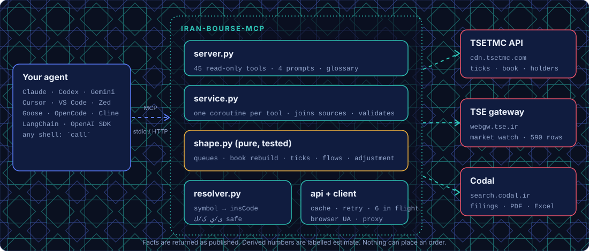

<div align="center">



<br>

[](https://github.com/msmahdinejad/iran-bourse-mcp/actions/workflows/ci.yml)
[](LICENSE)
[](pyproject.toml)
[](https://modelcontextprotocol.io)
[](docs/TOOLS.md)
[](https://github.com/msmahdinejad/iran-bourse-mcp/stargazers)

**[Website](https://msmahdinejad.github.io/iran-bourse-mcp/)** · **[Install](#install)** · **[Benchmarks](#benchmarks)** · **[Tools](docs/TOOLS.md)** · **[Screener](docs/SCREENER.md)** · **[Real examples](docs/EXAMPLES.md)** · **[Data notes](docs/DATA_SOURCES.md)** · **[راهنمای فارسی](docs/GUIDE.fa.md)** · **[فارسی](README.fa.md)**

</div>

**An open-source [MCP](https://modelcontextprotocol.io) server that gives any AI agent complete, clean Tehran Stock Exchange (TSETMC / بورس تهران و فرابورس) and Codal data**: a **stock screener with its own filter language**, quotes, order book and queues, tick-by-tick trades, real-vs-legal money flow, options and futures, index history, funds, major shareholders, filings and more. Units are explicit, derived numbers are labelled, and nothing can place an order.

> Unofficial. Not affiliated with TSETMC, the Tehran Stock Exchange, Fara Bourse or Codal. Information only, **not investment advice**.

<div align="center">


[▶ 15-second tour (MP4)](docs/assets/promo.mp4) · [GIF for sharing](docs/assets/promo.gif)
</div>

## Why it exists

An agent with a web browser cannot really read the Iranian market. We tested it:

- **The site is an empty shell.** Fetching a symbol page from `tsetmc.com` returns a title and nothing else. Codal's report list comes back as unrendered `{{template}}` placeholders.
- **The hidden JSON API speaks in codes and has traps.** Fields like `qTotTran5J`, `pMeDem`, `zOrdMeOf`; the exchange's own `priceChange` was `0.0` for a stock that rose 120 rial; order-book history is a delta feed; shareholder rows come back twice.
- **A day of ticks is 3 MB of JSON.** Nobody should paste that into a context window.

`iran-bourse-mcp` finds the data, fixes the traps, reassembles what is fragmented, summarises what is huge and labels everything it infers.

## Install

Works with **every MCP client**, and with agents that have none. You need [uv](https://docs.astral.sh/uv/) (`powershell -c "irm https://astral.sh/uv/install.ps1 | iex"` or `curl -LsSf https://astral.sh/uv/install.sh | sh`) and a machine in Iran ([why](#the-iranian-ip-requirement)).

```bash
# 1. check that TSETMC and Codal are reachable from here
uvx --from git+https://github.com/msmahdinejad/iran-bourse-mcp iran-bourse-mcp doctor

# 2. print the exact steps for your agent, or let the tool edit the config for you
uvx --from git+https://github.com/msmahdinejad/iran-bourse-mcp iran-bourse-mcp config cursor
uvx --from git+https://github.com/msmahdinejad/iran-bourse-mcp iran-bourse-mcp install cursor
```

The server entry is always the same: command `uvx`, args `["--from", "git+https://github.com/msmahdinejad/iran-bourse-mcp", "iran-bourse-mcp"]`, stdio transport. One-click install buttons for Cursor, VS Code and Goose are on the [website](https://msmahdinejad.github.io/iran-bourse-mcp/#install). An AI agent can set it up from [docs/llms-install.md](docs/llms-install.md).

<!-- INSTALL:START -->
<details>
<summary><b>All agents and IDEs: copy-paste recipes (17)</b></summary>

#### Claude Code
```bash
claude mcp add iran-bourse -- uvx --from git+https://github.com/msmahdinejad/iran-bourse-mcp iran-bourse-mcp
```
> Add `--scope user` to make it available in every project.

#### Claude Desktop
Add to the config file (Windows: `%APPDATA%/Claude/claude_desktop_config.json`; macOS: `~/Library/Application Support/Claude/claude_desktop_config.json`; Linux: `~/.config/Claude/claude_desktop_config.json`):

```json
{
  "mcpServers": {
    "iran-bourse": {
      "command": "uvx",
      "args": [
        "--from",
        "git+https://github.com/msmahdinejad/iran-bourse-mcp",
        "iran-bourse-mcp"
      ]
    }
  }
}
```
Or automatically (makes a backup first): `iran-bourse-mcp install claude-desktop`
> Restart Claude Desktop after editing the file.

#### OpenAI Codex CLI
```bash
codex mcp add iran-bourse -- uvx --from git+https://github.com/msmahdinejad/iran-bourse-mcp iran-bourse-mcp
```
or in `~/.codex/config.toml`:

```toml
[mcp_servers.iran-bourse]
command = "uvx"
args = ["--from", "git+https://github.com/msmahdinejad/iran-bourse-mcp", "iran-bourse-mcp"]
```
> `uvx --version` must work in the shell that starts Codex. For scripted `codex exec` runs use the config.toml form (required = true), or `uv tool install` the package so the server starts in about a second.

#### Gemini CLI
Add to `~/.gemini/settings.json`:

```json
{
  "mcpServers": {
    "iran-bourse": {
      "command": "uvx",
      "args": [
        "--from",
        "git+https://github.com/msmahdinejad/iran-bourse-mcp",
        "iran-bourse-mcp"
      ]
    }
  }
}
```
Or automatically (makes a backup first): `iran-bourse-mcp install gemini-cli`

#### Cursor
Add to `~/.cursor/mcp.json`:

```json
{
  "mcpServers": {
    "iran-bourse": {
      "command": "uvx",
      "args": [
        "--from",
        "git+https://github.com/msmahdinejad/iran-bourse-mcp",
        "iran-bourse-mcp"
      ]
    }
  }
}
```
Or automatically (makes a backup first): `iran-bourse-mcp install cursor`
> Restart Cursor after editing. A one-click install link is available (see `config cursor`).

#### VS Code (GitHub Copilot)
Add to `.vscode/mcp.json`:

```json
{
  "servers": {
    "iran-bourse": {
      "type": "stdio",
      "command": "uvx",
      "args": [
        "--from",
        "git+https://github.com/msmahdinejad/iran-bourse-mcp",
        "iran-bourse-mcp"
      ]
    }
  }
}
```
> Project-level file. Top-level key is `servers`, not `mcpServers`.

#### Windsurf
Add to `~/.codeium/windsurf/mcp_config.json`:

```json
{
  "mcpServers": {
    "iran-bourse": {
      "command": "uvx",
      "args": [
        "--from",
        "git+https://github.com/msmahdinejad/iran-bourse-mcp",
        "iran-bourse-mcp"
      ]
    }
  }
}
```
Or automatically (makes a backup first): `iran-bourse-mcp install windsurf`
> Newer releases may relocate the file; open it from Cascade's MCP panel if this path is missing.

#### Cline
Add this entry in the client's MCP settings:

```json
{
  "mcpServers": {
    "iran-bourse": {
      "command": "uvx",
      "args": [
        "--from",
        "git+https://github.com/msmahdinejad/iran-bourse-mcp",
        "iran-bourse-mcp"
      ]
    }
  }
}
```
> Open the MCP Servers panel, choose *Configure MCP Servers*, and paste the entry into the JSON it opens.

#### Roo Code
Add to `.roo/mcp.json`:

```json
{
  "mcpServers": {
    "iran-bourse": {
      "command": "uvx",
      "args": [
        "--from",
        "git+https://github.com/msmahdinejad/iran-bourse-mcp",
        "iran-bourse-mcp"
      ]
    }
  }
}
```
> Project file shown; the global file is opened from the MCP settings view.

#### Kiro
Add to `~/.kiro/settings/mcp.json`:

```json
{
  "mcpServers": {
    "iran-bourse": {
      "command": "uvx",
      "args": [
        "--from",
        "git+https://github.com/msmahdinejad/iran-bourse-mcp",
        "iran-bourse-mcp"
      ]
    }
  }
}
```
Or automatically (makes a backup first): `iran-bourse-mcp install kiro`

#### Qwen Code
Add to `~/.qwen/settings.json`:

```json
{
  "mcpServers": {
    "iran-bourse": {
      "command": "uvx",
      "args": [
        "--from",
        "git+https://github.com/msmahdinejad/iran-bourse-mcp",
        "iran-bourse-mcp"
      ]
    }
  }
}
```
Or automatically (makes a backup first): `iran-bourse-mcp install qwen-code`

#### JetBrains AI Assistant
Add this entry in the client's MCP settings:

```json
{
  "mcpServers": {
    "iran-bourse": {
      "command": "uvx",
      "args": [
        "--from",
        "git+https://github.com/msmahdinejad/iran-bourse-mcp",
        "iran-bourse-mcp"
      ]
    }
  }
}
```
> Settings > Tools > AI Assistant > Model Context Protocol (MCP) > Add, then paste the JSON.

#### Zed
Add to `~/.config/zed/settings.json`:

```json
{
  "context_servers": {
    "iran-bourse": {
      "command": "uvx",
      "args": [
        "--from",
        "git+https://github.com/msmahdinejad/iran-bourse-mcp",
        "iran-bourse-mcp"
      ]
    }
  }
}
```
> Older Zed versions expect `command` as an object: {"path": ..., "args": [...]}.

#### OpenCode
Add to `~/.config/opencode/opencode.json`:

```json
{
  "mcp": {
    "iran-bourse": {
      "type": "local",
      "command": [
        "uvx",
        "--from",
        "git+https://github.com/msmahdinejad/iran-bourse-mcp",
        "iran-bourse-mcp"
      ],
      "enabled": true
    }
  }
}
```
> OpenCode uses `command` as one array and `type: local`.

#### Goose
```bash
uvx --from git+https://github.com/msmahdinejad/iran-bourse-mcp iran-bourse-mcp
```

Paste that into `goose configure` > Add Extension > Command-line Extension, or open the one-click link on the website.
> Or run `goose configure` > Add Extension > Command-line Extension and enter the command below.

#### Amp
Add to `~/.config/amp/settings.json`:

```json
{
  "amp.mcpServers": {
    "iran-bourse": {
      "command": "uvx",
      "args": [
        "--from",
        "git+https://github.com/msmahdinejad/iran-bourse-mcp",
        "iran-bourse-mcp"
      ]
    }
  }
}
```

#### Python agent frameworks and plain shell
**OpenAI Agents SDK**

```python
from agents import Agent
from agents.mcp import MCPServerStdio

async with MCPServerStdio(params={"command": "uvx", "args": ["--from", "git+https://github.com/msmahdinejad/iran-bourse-mcp", "iran-bourse-mcp"]}) as bourse:
    agent = Agent(name="Analyst", instructions="Answer with exchange data.", mcp_servers=[bourse])
```
**LangChain**

```python
from langchain_mcp_adapters.client import MultiServerMCPClient

client = MultiServerMCPClient({
    "iran-bourse": {"transport": "stdio", "command": "uvx", "args": ["--from", "git+https://github.com/msmahdinejad/iran-bourse-mcp", "iran-bourse-mcp"]}
})
tools = await client.get_tools()
```
**Claude Agent SDK**

```python
from claude_agent_sdk import ClaudeAgentOptions

options = ClaudeAgentOptions(mcp_servers={"iran-bourse": {"command": "uvx", "args": ["--from", "git+https://github.com/msmahdinejad/iran-bourse-mcp", "iran-bourse-mcp"]}})
```
**No MCP support? Use the shell**

```bash
# Any agent that can run commands can use every tool:
uvx --from git+https://github.com/msmahdinejad/iran-bourse-mcp iran-bourse-mcp tools
uvx --from git+https://github.com/msmahdinejad/iran-bourse-mcp iran-bourse-mcp call quote symbol=فولاد --compact
uvx --from git+https://github.com/msmahdinejad/iran-bourse-mcp iran-bourse-mcp call top_movers kind=buy_queue limit=5 --compact
```

</details>

<!-- INSTALL:END -->

## What you can ask

> «وضعیت فولاد رو کامل بررسی کن: صف، ورود پول حقیقی، سهامداران عمده و آخرین اطلاعیه‌های کدال»
> «امروز کدوم سهم‌ها صف خرید قوی دارن و پول حقیقی وارد شده؟»
> «ریز معاملات فولاد دیروز رو خلاصه کن و بزرگ‌ترین معامله‌ها رو نشون بده»
> «صف خرید خودرو از چه ساعتی شکل گرفت و چقدر بزرگ شد؟»
> «سهامدار عمده شستا چه سهم‌های دیگه‌ای داره؟»
> «سهم‌هایی رو پیدا کن که امروز حجمشون بیش از دو برابر میانگین ۲۰ روز بوده، دیروز بیش از ۱٪ رشد کرده و امروز هم مثبته» ← [اسکرینر](docs/SCREENER.md)
> «زنجیره اختیار معامله اهرم رو با نزدیک‌ترین سررسید بده» · «تاریخچه شاخص کل از اول مهر» · «افزایش سرمایه‌های هفته آینده کدوم نمادهاست؟»

## The stock screener

`screen_stocks` is the filter box of tsetmc.com, written by your agent. Describe what you want; the agent writes a short condition and gets back only the stocks that pass it, with the evidence for each hit. It reads today's live values, up to 60 past trading days (adjusted for capital increases), real-vs-legal flow and a five-level order book for every instrument of the exchange's own market watch (about 3,700, including funds, bonds, options and futures).

```text
You:    stocks trading over twice their 20-day average volume, up more than 1% yesterday, positive today, over 5 billion rial
Agent:  screen_stocks(filter="volume > 2 * avg(volume, 20) and close_pct[1] > 1 and close_pct > 0 and value > 5B")
        35 of 625 stocks match, 3.6 s: انتخاب (9.4x volume, +2.97% yesterday, +2.85% today), پکرمان, کرماشا, خراسان ...
```

The language is a safe expression grammar (parsed with `ast`, never `eval`), accepts the field names and JavaScript spellings of the exchange's own filter (`pl`, `pc`, `tvol`, `tmax`, `pd1`, `ct.Buy_I_Volume`, `===`), ships 15 ready-made presets (`volume_surge`, `smart_money`, `breakout_20d`, `buy_queue` ...) and reports mistakes with suggestions. Checked against an independent re-implementation straight from raw exchange data: identical results on three different screens. Guide and every field: [docs/SCREENER.md](docs/SCREENER.md).

## Coverage

| Data | Tools |
|---|---|
| Market state, indices, industry indices | `market_status` `market_overview` `indices` `industry_summary` `index_contributors` |
| Whole-market tables (~3,700 instruments: shares, funds, bonds, options, futures) | `market_watch` `top_movers` (gainers, losers, buy/sell queues, real-money inflow/outflow, buyer power) `market_snapshot` |
| **Stock screener** (filter language, history, presets) | `screen_stocks` `screener_reference` |
| Index history, members and their effect | `index_history` (daily since 2008, or today's 5-minute path) `index_constituents` |
| Options and futures | `option_chain` (calls and puts by strike and expiry, moneyness, intrinsic value, open interest) `futures_market` (basis) |
| The exchange's own best-of lists (برترین‌ها) | `top_lists` (69 lists: blocks, rights, ETFs, queues, options ...) |
| Corporate-action calendar | `capital_calendar` (upcoming capital increases, price adjustments) |
| Halts and supervision | `trading_status` (suspended, under caution, state changes, one symbol's history) |
| One-call symbol dossier | `symbol_overview` |
| Price, limits, VWAP, P/E, market cap | `quote` `price_history` (optionally **back-adjusted**) `symbol_statistics` `corporate_actions` |
| Order book and queues (صف خرید/فروش) | `order_book` `order_book_history` (rebuilt from every event, with queue episodes) |
| Tick-by-tick trades (ریز معاملات) | `trades` (filterable) `trade_summary` (bars, VWAP, biggest trades, price levels, pressure estimate, **coverage check**) |
| Real vs legal investors (حقیقی/حقوقی) | `real_legal_flow` (per-capita, buyer power, net flow, daily history) |
| Shareholders (سهامداران عمده) | `shareholders` `shareholder_history` (also one holder's position over time) `shareholder_portfolio` `market_holder_moves` |
| Funds | `fund_ranking` (579 funds: NAV, returns, size, portfolio mix) `etf_nav` (premium/discount to issue and redemption NAV) |
| Codal | `codal_filings` (links to page, PDF, Excel) `codal_company` |
| Supervisor notices | `supervisor_messages` |
| Vocabulary | `glossary` (Persian ↔ English market terms) |

Also four prompts (`analyze_symbol`, `daily_market_report`, `smart_money_scan`, `find_stocks`) and a glossary resource. Full parameters: [docs/TOOLS.md](docs/TOOLS.md).

## Benchmarks

Measured against the live exchange, not claimed. The raw route is the **best case** for an agent that already knows the hidden endpoints. Scripts, ground truth and raw results live in [`benchmarks/`](benchmarks/README.md) and can be re-run.

<!-- BENCH:START -->
<div align="center">


</div>

| Task | Raw route | iran-bourse-mcp | Tokens saved |
|---|---|---|---|
| Live quote with correct % change | 3 req · 0.4s · 6,225 tok | 1 call · 0.5s · 337 tok | **18x** |
| Order book with queue detection | 3 req · 0.3s · 6,298 tok | 1 call · 0.6s · 388 tok | **16x** |
| One day of ticks: VWAP, biggest trades, bars | 3 req · 0.7s · 2,142,302 tok | 1 call · 1.1s · 3,380 tok | **634x** |
| Real vs legal money flow, 10 days | 12 req · 0.9s · 612,009 tok | 1 call · 1.2s · 1,332 tok | **460x** |
| Major shareholders | 3 req · 0.4s · 7,018 tok | 1 call · 0.7s · 686 tok | **10x** |
| Market-wide ranking of buy queues | 222 req · 15.0s · 695,971 tok | 1 call · 9.4s · 1,241 tok | **561x** |
| Latest 5 Codal filings with links | 1 req · 1.6s · 6,489 tok | 1 call · 1.6s · 1,539 tok | **4x** |
| One year of daily prices, adjusted | 2 req · 0.4s · 610,549 tok | 1 call · 0.8s · 19,517 tok | **31x** |
| Screen the market: volume > 2x 20-day average, up yesterday and today | 22 req · 5.8s · 7,437,128 tok | 1 call · 3.9s · 723 tok | **10,286x** |

_Data-plane benchmark, 2026-11-04 15:51:55 UTC. Tokens are a tiktoken `o200k_base` proxy; the ratios matter more than the absolute numbers. A single-endpoint task takes about as long either way; the server wins where the raw route needs many sequential requests, and on tokens everywhere._

**Traps in the raw data** (each found on the live endpoints and handled by the server):

| Trap | Naive reading | Correct |
|---|---|---|
| The exchange's own `priceChange` field in GetClosingPriceInfo | `0.0` | `120.0` |
| Counting holders / summing percent from the dated shareholder endpoint | `{"holders": 24, "percent_sum": 92.97}` | `{"holders": 12, "percent_sum": 46.48}` |
| Reading real-buyer count with the key used by the live endpoint (`buy_CountI`) on history rows | `null` | `3790.0` |
| Calling every limit-up stock without visible sell orders a buy queue, using the gateway's market watch alone | `85` | `83` |
| Matching the company name the user types (Persian letters) against the exchange's text (Arabic letters) | `false` | `true` |

**Agent trials** (one LLM agent model, identical in every arm, 2026-11-04; 6 tasks, graded against independent ground truth):

| Agent | Accuracy | Net tokens (mean/task) | Time (mean/task) | Tool calls | Answered |
|---|---|---|---|---|---|
| Browser-only agent (page fetch) | 21% | 100,054 | 190s | 9.2 | 4/6 |
| Shell agent (curl/python + web, no MCP) | 94% | 17,129 | 83s | 6.8 | 6/6 |
| Agent + iran-bourse-mcp | 100% | 11,512 | 36s | 3.0 | 6/6 |

_Six tasks, one model, runs per task: 1 (2 for T2 and T6 in the shell and MCP arms). The shell agent used its own knowledge of the exchange's endpoints. On T4 it classified a fixed-price symbol (فولاد3) as an ordinary share, a different but defensible reading of 'ordinary shares'; queue sizes also drift by tens of percent within minutes after the close, so T4 is graded on the ranking only._

<!-- BENCH:END -->

### Verified, not assumed

- **Ticks are complete.** For فولاد the 6,819 ticks of 3 Nov and the 15,643 ticks of 2 Nov matched the exchange's own daily totals at **100.0% of volume and trade count**. `trade_summary` reports this coverage on every call so you do not have to trust us. (A community reference claimed a 36-38% shortfall; we could not reproduce that.)
- **Price limits and queues** come from the day's actual allowed price range, not a guess, and queue rankings are confirmed against the real order book.
- **Derived numbers are labelled.** Anything the exchange does not publish (tick-rule pressure, adjusted prices, same-day value of real money flow) sits under an `estimate`/`estimated` key.
- **Tested.** Offline tests on recorded real fixtures (CI: Python 3.10 to 3.13 on both MCP SDK generations), a live smoke test of every tool (`scripts/smoke_live.py`) and an end-to-end stdio test (`scripts/e2e_stdio.py`).

## Architecture

<div align="center"></div>

Pure transformation logic (`shape.py`) is separated from I/O so every number can be tested offline. Details: [docs/ARCHITECTURE.md](docs/ARCHITECTURE.md).

## The Iranian IP requirement

TSETMC and Codal are built for Iranian users. Their servers often reject foreign or VPN addresses. So:

- Run the server on a machine in Iran, not behind a foreign VPN, **or**
- point it at an in-Iran proxy: `IRAN_BOURSE_PROXY=http://host:port`, **or**
- run it on an Iranian server and connect remotely over HTTP (use an SSH tunnel or a reverse proxy with authentication; the server has no auth of its own):

```bash
iran-bourse-mcp serve --transport streamable-http --host 127.0.0.1 --port 8000
```

`iran-bourse-mcp doctor` tells you which sources are reachable. A `Dockerfile` is included (`docker build -t iran-bourse-mcp . && docker run -i --rm iran-bourse-mcp`); images are pushed to `ghcr.io` on tagged releases.

## Configuration

| Variable | Purpose | Default |
|---|---|---|
| `IRAN_BOURSE_PROXY` | HTTP(S) proxy for all requests | none (system proxy variables are honoured) |
| `IRAN_BOURSE_TIMEOUT` | Request timeout, seconds | `45` |
| `IRAN_BOURSE_SOURCE` | Package source used in generated install snippets (`pypi` once published) | the GitHub repository |
| `IRAN_BOURSE_CDN_URL` | Override the TSETMC API base | `https://cdn.tsetmc.com/api` |
| `IRAN_BOURSE_WEBGW_URL` | Override the TSE gateway base | `https://webgw.tse.ir` |
| `IRAN_BOURSE_CODAL_URL` | Override the Codal search API | `https://search.codal.ir/api/search/v2/q` |

## Good to know

- Prices and values are in **Rial** (1 Toman = 10 Rial). Dates accept Gregorian (`2026-11-03`) or Jalali (`1405/08/12`, Persian digits fine).
- Persian/Arabic letter variants are interchangeable on input (`کگل` = `كگل`) and normalised on output.
- The market trades Saturday-Wednesday 09:00-12:30 Tehran time, except on official public holidays. `market_status` knows the 1405 holiday calendar (`holiday`, `next_session`, `upcoming_holidays`); for years not yet in the table only the fixed Solar Hijri holidays are known. The exchange also closes on some days without a holiday; `market_status` flags it when the exchange's own data disagrees with the calendar. Outside the session you get the last session's data.
- **Order-book history for the current trading day may be partial.** TSETMC publishes the full intraday book history only after the day ends. `order_book_history` tells you when it is cut short (`events_span`, `warning`). Use `order_book` for the live book.
- The unofficial endpoints can change without notice. Every quirk we found is in [docs/DATA_SOURCES.md](docs/DATA_SOURCES.md).
- Requests are cached briefly (seconds for live data, hours for history) and limited to 6 in flight. Please be gentle: this is somebody else's server.

## Troubleshooting

| Symptom | Fix |
|---|---|
| `spawn uvx ENOENT` or "command not found" in the client | GUI clients (Claude Desktop, Cursor) may not see your shell `PATH`. Put the absolute path in `command` (`where uvx` on Windows, `which uvx` elsewhere). |
| First start takes ~10 seconds | `uvx` downloads and caches the dependencies once. Later starts are instant. Pin it with `uv tool install git+https://github.com/msmahdinejad/iran-bourse-mcp` and use the `iran-bourse-mcp` command directly. |
| `HTTP 403` or "Could not reach" | The Iranian IP requirement above. Run `iran-bourse-mcp doctor` to see which host fails. |
| "The exchange server answered HTTP 502/503" | TSETMC is overloaded. The server already retried; try again in a few seconds. |
| Empty or old live data | The market is closed (Saturday-Wednesday 09:00-12:30 Tehran time); you get the last session. |
| Persian text looks reversed in a terminal | Terminal bidi rendering, not a data problem. The JSON is correct. |

## Safety

All tools are read-only (`readOnlyHint`). There is deliberately **no order placement**, no login and no credential handling.

## Development

```bash
uv sync
uv run pytest                           # offline, a few seconds
uv run ruff check .
uv run python scripts/smoke_live.py     # needs access to TSETMC
uv run python scripts/e2e_stdio.py      # real MCP handshake against live data
uv run python benchmarks/data_plane.py  # re-measure tokens, requests, time
```

See [CONTRIBUTING.md](CONTRIBUTING.md), [AGENTS.md](AGENTS.md) and [docs/ARCHITECTURE.md](docs/ARCHITECTURE.md).

## Roadmap

- IME commodity and energy bourse data
- Holiday table for Jalali year 1406 (once the official calendar is final)
- Published PyPI release (`uvx iran-bourse-mcp`)

## Citing

See [CITATION.cff](CITATION.cff). Licensed under [MIT](LICENSE). Market data belongs to its respective owners; check the exchange's terms before redistributing it.
